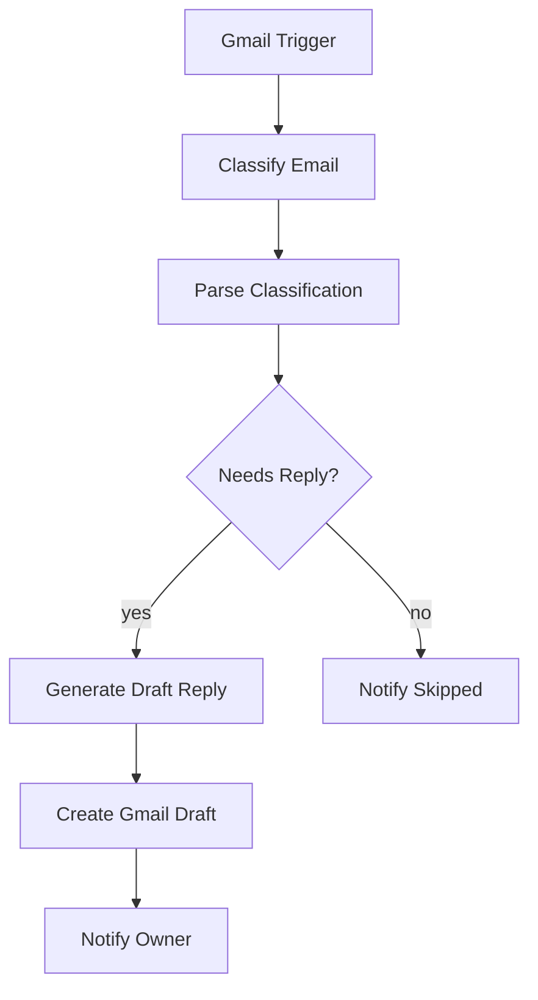

# agedcare-automation

AI 邮件助手（n8n 工作流）：自动分类收件箱邮件、按预设风格指南生成回复草稿存入 Gmail Drafts，人工审核后才发送——不自动外发。

## Features

- **邮件分类**：LLM 输出类别 / 优先级 / 是否需回复 / 跟进项（JSON）
- **草稿生成**：按可配置的风格指南生成回复，写入同一线程的 Gmail Draft
- **人工兜底**：LLM 输出解析失败或无需回复时，均发通知提醒人工处理
- **错误告警**：任一工作流失败自动邮件通知负责人

## Tech Stack

- **n8n**（self-hosted Docker 或 n8n Cloud），已在 n8n 2.44.5 验证
- **Gemini 3.5 Flash Lite**（经 OpenAI 兼容端点接入）
- **Gmail API**（OAuth2）

## Prerequisites

- Docker Desktop（本地部署）或 n8n Cloud 账号
- Google Cloud 项目：启用 Gmail API 并创建 OAuth2 凭据
- Gemini API key

## Quick Start

```powershell
# 1. 启动 n8n（本地数据挂载在 .n8n/）
docker run -d --name n8n-agedcare -p 5678:5678 `
  -v "<repo-path>/.n8n:/home/node/.n8n" `
  n8nio/n8n:latest

# 2. 打开 http://localhost:5678，创建 owner 账号
# 3. 导入 workflows/ 下两个 JSON 工作流
# 4. 按下表完成 Configuration
```

## Configuration

上线前必须完成：

| 位置 | 配置项 |
|---|---|
| 所有 Gmail 节点 | 绑定目标邮箱的 Gmail OAuth2 凭据（Google Cloud 开 Gmail API） |
| 两个 OpenAI 模型节点 | 创建 OpenAI credential：API key 填 自己的Gemini key，如果没有则去 https://aistudio.google.com/app/api-keys 申请，Base URL 覆盖为 `https://generativelanguage.googleapis.com/v1beta/openai/`；模型已预设 `gemini-3.5-flash-lite` |
| `Generate Draft Reply` 的 system prompt | 把 STYLE GUIDE 占位符换成 5-10 封真实邮件样例，署名改真实姓名 |
| `Notify Owner` / `Notify Skipped` 的 `sendTo` | `owner@example.com` → 负责人邮箱 |
| 主 workflow 设置 | Settings → Error Workflow 选 `Error Alert` |

导入后以下设置不会从 JSON 带过来，需逐项检查（n8n 2.x schema 差异）：

| 节点 | 检查项 |
|---|---|
| `Classify Email` / `Generate Draft Reply` | **Source for Prompt** 设为 `Define Below`，并确认 Prompt 文本存在 |
| 两个 OpenAI 模型节点 | **Options → Use Responses API 关闭**——Gemini 兼容端点只支持 chat completions，开着会报 404 |
| `Parse Classification` | Language 保持 `JavaScript`（Python 模式需容器内安装 Python 3，官方镜像没有） |
| `Error Alert` workflow | 先 **Publish**，主流程的 Error Workflow 下拉才可选；错误告警只对生产执行触发，手动 Execute 不发 |

## Workflow



| 节点 | 说明 |
|---|---|
| Gmail Trigger | 每 5 分钟检查收件箱未读邮件，跳过促销 / 社交 / 聊天类 |
| Classify Email | LLM 输出 JSON：类别 / 优先级 / 是否需回复 / 跟进项 |
| Parse Classification | 容错解析 LLM 输出，失败默认转人工审核 |
| Generate Draft Reply | 按风格指南生成回复正文 |
| Create Gmail Draft | 写入原邮件线程的草稿，**不发送** |
| Notify Owner | 邮件通知负责人：优先级 + 摘要 |
| Notify Skipped | 通知被跳过的邮件及原因，防止漏看 |

两条分支都会通知负责人，确保没有任何邮件被静默处理。

## AI 输出说明

`Classify Email` 的 system prompt 定义了分类规则，每封邮件输出一个 JSON：

| 字段 | 取值 | 含义 |
|---|---|---|
| `category` | `client_enquiry` / `family_member` / `staff` / `supplier` / `government_regulator` / `newsletter` / `notification` / `spam` / `other` | 邮件类别 |
| `priority` | `urgent` / `normal` / `low` | 优先级；urgent = 健康安全/投诉/时效性强 |
| `needs_reply` | true / false | 是否需要回复（决定走草稿还是跳过分支） |
| `skip_reason` | 字符串 | 不回复的原因（needs_reply=false 时） |
| `summary` | 字符串 | 一句话摘要，**不含健康隐私细节** |
| `follow_ups` | 数组 | LLM 识别出的跟进事项 |

**查看实际分类结果**：n8n 左栏 Executions → 打开某次执行 → 点 `Parse Classification` 节点，输出 item 的 `json` 即完整结果；优先级同时体现在 `Notify Owner` 邮件标题的 `[URGENT]`/`[NORMAL]`/`[LOW]` 前缀。

要调整分类口径（增删类别、改 urgent 定义），改 `Classify Email` 的 system prompt 即可，代码不用动。可用 `test-samples/sample-emails.md` 的 8 封测试邮件逐类验证效果。

## Deployment

- **n8n Cloud**：导入 `workflows/` 下 JSON，按 Configuration 绑定凭据
- **自托管**：常开主机 + Docker（见 Quick Start），数据不出本地
