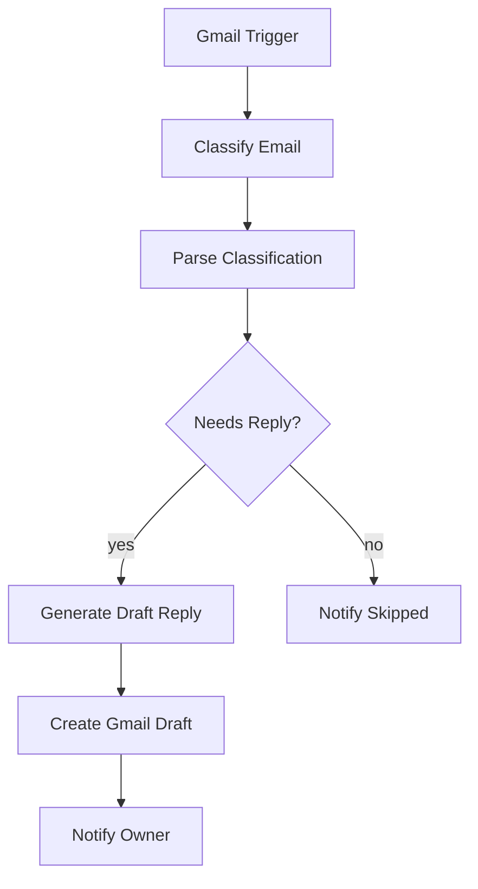

<a id="readme-top"></a>

# agedcare-automation

**English** | [简体中文](README.zh-CN.md)

AI email assistant (n8n workflows): classifies inbox emails and drafts replies in a configurable style, saved to Gmail Drafts — a human reviews before anything is sent. Nothing goes out automatically.

Built for: inbox triage at a small Australian aged care provider.

## Repo Layout

| Path | Contents |
|---|---|
| `workflows/AI Email Assistant - Draft Replies for Review.json` | Main flow: classify → draft → notify |
| `workflows/Error Alert - Notify on Workflow Failure.json` | Error alert: emails the owner on any workflow failure |
| `test-samples/sample-emails.md` | 8 test emails + expected behavior + verification checklist |
| `test-samples/sample-replies.md` | Reply style samples (for the STYLE GUIDE in `Generate Draft Reply`) |

<p align="right">(<a href="#readme-top">back to top</a>)</p>

## Features

- **Email classification** — LLM outputs category / priority / needs-reply / follow-ups (JSON)
- **Draft generation** — replies written per a configurable style guide, saved as Gmail drafts in the original thread
- **Human fallback** — unparseable LLM output or no-reply emails still trigger a notification for manual review
- **Error alerts** — any workflow failure emails the owner

<p align="right">(<a href="#readme-top">back to top</a>)</p>

## Tech Stack

- **n8n** (self-hosted Docker or n8n Cloud) — verified on n8n 2.44.5
- **Gemini 3.5 Flash Lite** — via Google's OpenAI-compatible endpoint
- **Gmail API** — OAuth2

<p align="right">(<a href="#readme-top">back to top</a>)</p>

## Prerequisites

- Docker Desktop (local) or an n8n Cloud account
- A Google Cloud project (Gmail OAuth2 — see step 2)
- A Gemini API key (free at https://aistudio.google.com/app/api-keys)

<p align="right">(<a href="#readme-top">back to top</a>)</p>

## Quick Start

### 1. Start n8n

```powershell
docker run -d --name n8n-agedcare --restart unless-stopped -p 5678:5678 `
  -v "<repo-path>/.n8n:/home/node/.n8n" `
  n8nio/n8n:2.44.5
```

- Replace `<repo-path>` with the **absolute path** of this repo; `.n8n/` (gitignored) holds n8n credentials and execution data
- macOS/Linux: use `\` for line continuation, and run `mkdir .n8n` first (Docker would otherwise create it as root, which the container's `node` user can't write to)
- Optional: `-e GENERIC_TIMEZONE=Australia/Sydney`

Open http://localhost:5678 and create the owner account.

### 2. Google Cloud + Gmail OAuth2

1. Google Cloud Console → APIs & Services → enable the **Gmail API**
2. OAuth consent screen → External → fill in the app info
3. Credentials → Create **OAuth client ID** → type *Web application* → Authorized redirect URI = the **OAuth Redirect URL** shown in the n8n credential dialog (local default: `http://localhost:5678/rest/oauth2-credential/callback`)
4. n8n → Credentials → New → **Gmail OAuth2 API** → paste Client ID / Secret → Sign in with Google

> **Important**: the consent screen must be **Published to Production**. Left in Testing, the refresh token expires every 7 days and the Gmail credential breaks weekly. (Alternative: keep Testing and add the target mailbox as a test user.)

### 3. Gemini credential

n8n → Credentials → New → **OpenAI**:

- API Key: your Gemini key
- Override the Base URL with `https://generativelanguage.googleapis.com/v1beta/openai/`

### 4. Import workflows

Create Workflow → Import from File → import both JSONs under `workflows/`, then complete the **Configuration** steps ①–④ below.

<p align="right">(<a href="#readme-top">back to top</a>)</p>

## Configuration (post-import checklist)

The JSONs are sanitized — no credentials are included, and placeholders are `owner@example.com` (recipients) and `[Owner Name]` (signature). You can find-and-replace placeholders in the JSON before import, or edit the nodes afterwards. In order:

**① Bind credentials** — imported nodes have none; open each node and select:

| Nodes | Credential |
|---|---|
| `Gmail Trigger` / `Create Gmail Draft` / `Notify Owner` / `Notify Skipped` (main) + `Send Alert Email` (Error Alert) | Gmail OAuth2 from step 2 |
| `LLM for Classify` / `LLM for Draft` | OpenAI credential from step 3; if the model dropdown is empty, type `models/gemini-3.5-flash-lite` manually |

**② Replace placeholders**

| Location | Change |
|---|---|
| `sendTo` of `Notify Owner` / `Notify Skipped` / `Send Alert Email` | `owner@example.com` → the owner's email |
| system prompt of `Generate Draft Reply` | ships with 3 sample replies signed `[Owner Name]` — replace with 3–5 real owner replies and fix the signature (format reference: `test-samples/sample-replies.md`) |

**③ Check settings that don't survive import** (n8n 2.x schema differences):

| Node | Check |
|---|---|
| `Classify Email` / `Generate Draft Reply` | **Source for Prompt** = `Define Below`, and the prompt text is present |
| Both OpenAI model nodes | **Options → Use Responses API: OFF** — Gemini's compatible endpoint only supports chat completions; leaving it on returns 404 |
| `Parse Classification` | Language stays `JavaScript` (Python mode requires Python 3 inside the container — not in the official image) |
| `Error Alert` workflow | **Publish it first**, or it won't appear in the main workflow's Error Workflow dropdown; error alerts only fire on production executions, not manual runs |

**④ Publish**

1. Publish `Error Alert` → open the main workflow → Settings → Error Workflow → select `Error Alert`
2. Publish the main workflow — the Gmail Trigger won't poll until published

<p align="right">(<a href="#readme-top">back to top</a>)</p>

## Verification

1. Make sure **both** workflows are published
2. From a **different mailbox** (not the bound one — the trigger filters `-from:me`), send a few test emails from `test-samples/sample-emails.md` to the bound mailbox
3. Wait up to 5 minutes for the poll (or temporarily remove `-from:me` from the trigger's `q` filter while testing)
4. Check against the checklist at the end of `sample-emails.md`: drafts appear in Gmail Drafts, Notify Owner / Notify Skipped emails arrive, Executions are all green

<p align="right">(<a href="#readme-top">back to top</a>)</p>

## Workflow



| Node | What it does |
|---|---|
| Gmail Trigger | polls unread inbox mail every 5 min; skips promotions / social / chats / self-sent mail |
| Classify Email | LLM outputs JSON: category / priority / needs-reply / follow-ups |
| Parse Classification | fault-tolerant parsing; failures default to human review (yes branch, flagged) |
| Generate Draft Reply | writes the reply body per the style guide |
| Create Gmail Draft | saves the draft into the original thread — **never sends** |
| Notify Owner | emails the owner: priority + summary |
| Notify Skipped | reports skipped emails and reasons, so nothing is silently dropped |

Both branches notify the owner — no email is processed silently. Notification emails are sent from the bound mailbox itself and are filtered by `-from:me`, so they never re-trigger the flow.

<p align="right">(<a href="#readme-top">back to top</a>)</p>

## AI Output Schema

`Classify Email`'s system prompt defines the rules; each email yields one JSON object:

| Field | Values | Meaning |
|---|---|---|
| `category` | `client_enquiry` / `family_member` / `staff` / `supplier` / `government_regulator` / `newsletter` / `notification` / `spam` / `other` | email category |
| `priority` | `urgent` / `normal` / `low` | urgent = health/safety, complaints, time-sensitive |
| `needs_reply` | true / false | routes to the draft vs. skip branch |
| `skip_reason` | string | why no reply (when `needs_reply` is false) |
| `summary` | string | one-line summary — **no personal health details** |
| `follow_ups` | array | action items detected by the LLM |

**Viewing actual results**: n8n sidebar → Executions → open a run → inspect the `Parse Classification` node's output `json`. Priority also appears as `[URGENT]` / `[NORMAL]` / `[LOW]` in the `Notify Owner` subject line.

To change categories or the urgent definition, edit the `Classify Email` system prompt — no code changes needed.

<p align="right">(<a href="#readme-top">back to top</a>)</p>

## Deployment

- **n8n Cloud**: import both JSONs → bind credentials → Publish. The OAuth Redirect URL becomes `https://<instance>.app.n8n.cloud/...` — add it to the Google Cloud OAuth client
- **Self-hosted**: the docker command above already includes `--restart unless-stopped`. The Gmail Trigger is **polling-based**, so n8n does not need to be publicly reachable. If you later serve n8n over a domain + HTTPS, update the redirect URI in Google Cloud

<p align="right">(<a href="#readme-top">back to top</a>)</p>

## Troubleshooting

| Symptom | Cause / fix |
|---|---|
| Nodes ask for a credential after import | expected — the JSONs ship without credentials; select one per Configuration ① |
| OpenAI node returns 404 | `Use Responses API` still on — see Configuration ③ |
| Gmail credential dies every few days | consent screen still in Testing → Publish to Production |
| Workflow never triggers | main workflow not published; or the test mail was sent from the bound mailbox itself |
| Credentials / executions gone after container rebuild | `-v` mount path wrong — check whether `.n8n/` has files |

<p align="right">(<a href="#readme-top">back to top</a>)</p>
