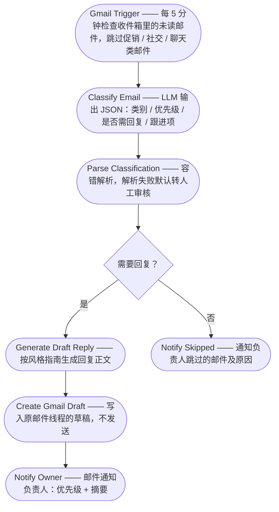

# agedcare-automation

AI 邮件助手（n8n 工作流）：自动分类收件箱邮件、按预设风格指南生成回复草稿存入 Gmail Drafts，人工审核后才发送——不自动外发。

## Features

- **邮件分类**：LLM 输出类别 / 优先级 / 是否需回复 / 跟进项（JSON）
- **草稿生成**：按可配置的风格指南生成回复，写入同一线程的 Gmail Draft
- **人工兜底**：LLM 输出解析失败或无需回复时，均发通知提醒人工处理
- **错误告警**：任一工作流失败自动邮件通知负责人

## Tech Stack

- **n8n**（self-hosted Docker 或 n8n Cloud），已在 n8n 2.44.5 验证
- **Gemini 3.1 Flash Lite**（经 OpenAI 兼容端点接入）
- **Gmail API**（OAuth2）

## Prerequisites

- Docker Desktop（本地部署）或 n8n Cloud 账号
- Google Cloud 项目：启用 Gmail API 并创建 OAuth2 凭据
- Gemini API key

## Quick Start

```powershell
# 1. 启动 n8n（本地数据挂载在 .n8n/）
docker run -d --name n8n-agedcare -p 5678:5678 `
  -v "<repo-path>/.n8n:/home/node/.n8n" `
  n8nio/n8n:latest

# 2. 打开 http://localhost:5678，创建 owner 账号
# 3. 导入 workflows/ 下两个 JSON 工作流
# 4. 按下表完成 Configuration
```

## Configuration

上线前必须完成：

| 位置 | 配置项 |
|---|---|
| 所有 Gmail 节点 | 绑定目标邮箱的 Gmail OAuth2 凭据（Google Cloud 开 Gmail API） |
| 两个 OpenAI 模型节点 | 创建 OpenAI credential：API key 填 Gemini key，Base URL 覆盖为 `https://generativelanguage.googleapis.com/v1beta/openai/`；模型已预设 `gemini-3.1-flash-lite` |
| `Generate Draft Reply` 的 system prompt | 把 STYLE GUIDE 占位符换成 5-10 封真实邮件样例，署名改真实姓名 |
| `Notify Owner` / `Notify Skipped` 的 `sendTo` | `owner@example.com` → 负责人邮箱 |
| 主 workflow 设置 | Settings → Error Workflow 选 `Error Alert` |

## Workflow



两条分支都会通知负责人，确保没有任何邮件被静默处理。

## Deployment

- **n8n Cloud**：导入 `workflows/` 下 JSON，按 Configuration 绑定凭据
- **自托管**：常开主机 + Docker（见 Quick Start），数据不出本地
