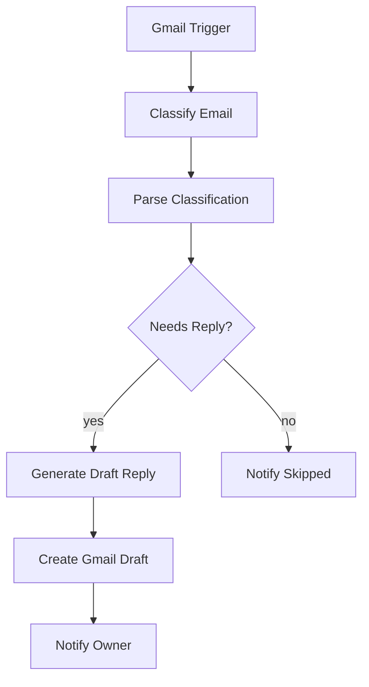

# agedcare-automation

[English](README.md) | **简体中文**

AI 邮件助手（n8n 工作流）：自动分类收件箱邮件、按预设风格指南生成回复草稿存入 Gmail Drafts，人工审核后才发送——不自动外发。

场景：澳洲小型 aged care 服务商的收件箱分拣。

## 仓库结构

| 路径 | 内容 |
|---|---|
| `workflows/AI Email Assistant - Draft Replies for Review.json` | 主流程：分类 → 生成草稿 → 通知 |
| `workflows/Error Alert - Notify on Workflow Failure.json` | 错误告警：任一工作流失败邮件通知负责人 |
| `test-samples/sample-emails.md` | 8 封测试邮件 + 预期行为 + 验证清单 |
| `test-samples/sample-replies.md` | 回复风格样例（替换 STYLE GUIDE 用） |

## 功能特性

- **邮件分类**：LLM 输出类别 / 优先级 / 是否需回复 / 跟进项（JSON）
- **草稿生成**：按可配置的风格指南生成回复，写入同一线程的 Gmail Draft
- **人工兜底**：LLM 输出解析失败或无需回复时，均发通知提醒人工处理
- **错误告警**：任一工作流失败自动邮件通知负责人

## 技术栈

- **n8n**（self-hosted Docker 或 n8n Cloud），已在 n8n 2.44.5 验证
- **Gemini 3.5 Flash Lite**（经 Google OpenAI 兼容端点接入）
- **Gmail API**（OAuth2）

## 前置要求

- Docker Desktop（本地部署）或 n8n Cloud 账号
- Google Cloud Gmail OAuth2 配置
- Gemini API key（https://aistudio.google.com/app/api-keys 免费申请）

## 快速开始

### 1. 启动 n8n

```powershell
docker run -d --name n8n-agedcare --restart unless-stopped -p 5678:5678 `
  -v "<repo-path>/.n8n:/home/node/.n8n" `
  n8nio/n8n:2.44.5
```

- 挂载路径换成**项目实际路径**；`.n8n/`（已 gitignore）存 n8n 凭据和执行数据
- macOS/Linux 把续行符 `` ` `` 换成 `\`，且先 `mkdir .n8n`
- 可选：`-e GENERIC_TIMEZONE=Australia/Sydney`

打开 http://localhost:5678，创建 owner 账号。

### 2. 配 Google Cloud + Gmail OAuth2

1. Google Cloud Console → APIs & Services → 启用 **Gmail API**
2. OAuth consent screen → External → 填应用信息
3. Credentials → Create **OAuth client ID** → 类型 Web application → Authorized redirect URI 填 n8n 凭据弹窗里显示的 **OAuth Redirect URL**（本地默认 `http://localhost:5678/rest/oauth2-credential/callback`）
4. n8n → Credentials → New → **Gmail OAuth2 API** → 填 Client ID / Secret → Sign in with Google

> **重要**：consent screen 必须 **Publish 到 Production**。留在 Testing 状态 refresh token 7 天失效，Gmail 凭据每周断连。不发布也行，但要把目标邮箱加为 test user。

### 3. 配 Gemini 凭据

n8n → Credentials → New → **OpenAI**：

- API Key：你的 Gemini key
- Base URL 覆盖为 `https://generativelanguage.googleapis.com/v1beta/openai/`

### 4. 导入工作流并配置

Create Workflow → Import from File → 依次导入 `workflows/` 两个 JSON，然后按 **配置清单** 完成 ①–④。

## 配置清单（导入后操作）

JSON 已脱敏：不含凭据，占位符为 `owner@example.com`（收件人）和 `[Owner Name]`（署名）——可导入前全局替换，也可导入后在节点里改。以下导入后在节点里修改，按顺序完成：

**① 绑凭据**——导入的节点没有任何凭据，逐个打开节点选择：

| 节点 | 凭据 |
|---|---|
| `Gmail Trigger` / `Create Gmail Draft` / `Notify Owner` / `Notify Skipped`（主流程）+ `Send Alert Email`（Error Alert） | 第 2 步建的 Gmail OAuth2 |
| `LLM for Classify` / `LLM for Draft` | 第 3 步建的 OpenAI；模型下拉为空时手填 `models/gemini-3.5-flash-lite` |

**② 改占位符**

| 位置 | 改什么 |
|---|---|
| `Notify Owner` / `Notify Skipped` / `Send Alert Email` 的 `sendTo` | `owner@example.com` → 负责人邮箱 |
| `Generate Draft Reply` 的 system prompt | 内置 3 个示例、署名 `[Owner Name]`——换成 3–5 封负责人真实回复并改署名（格式参考 `test-samples/sample-replies.md`） |

**③ 检查导入丢失项**（n8n 2.x schema 差异，不随 JSON 生效）：

| 节点 | 检查项 |
|---|---|
| `Classify Email` / `Generate Draft Reply` | **Source for Prompt** 为 `Define Below`，并确认 Prompt 文本存在 |
| 两个 OpenAI 模型节点 | **Options → Use Responses API 关闭**——Gemini 兼容端点只支持 chat completions，开着会报 404 |
| `Parse Classification` | Language 保持 `JavaScript`（Python 模式需容器内装 Python 3，官方镜像没有） |
| `Error Alert` workflow | 先 **Publish**，主流程 Error Workflow 下拉才可选；错误告警只对生产执行触发，手动 Execute 不发 |

**④ 发布**

1. Publish `Error Alert` → 打开主流程 → Settings → Error Workflow 选 `Error Alert`
2. Publish 主流程——不发布 Gmail Trigger 不会轮询

## 验证

1. 确认**两个** workflow 都已 Publish
2. **用另一个邮箱**（不能用绑定邮箱自己发——trigger 含 `-from:me` 过滤，自发邮件不触发）发几封 `test-samples/sample-emails.md` 里的测试邮件到绑定邮箱
3. 等最多 5 分钟轮询（测试期也可临时把 `-from:me` 从 trigger 的 `q` 里去掉）
4. 按 `sample-emails.md` 末尾清单核对：Drafts 里有草稿、收到 Notify Owner / Notify Skipped 邮件、Executions 全绿

## 工作流程



| 节点 | 说明 |
|---|---|
| Gmail Trigger | 每 5 分钟检查收件箱未读邮件，跳过促销 / 社交 / 聊天 / 自己发的邮件 |
| Classify Email | LLM 输出 JSON：类别 / 优先级 / 是否需回复 / 跟进项 |
| Parse Classification | 容错解析 LLM 输出，失败默认转人工审核（走 yes 分支并标注） |
| Generate Draft Reply | 按风格指南生成回复正文 |
| Create Gmail Draft | 写入原邮件线程的草稿，**不发送** |
| Notify Owner | 邮件通知负责人：优先级 + 摘要 |
| Notify Skipped | 通知被跳过的邮件及原因，防止漏看 |

两条分支都会通知负责人，确保没有任何邮件被静默处理。通知邮件由绑定邮箱自己发出，会被 `-from:me` 过滤，不会自我循环触发。

## AI 输出说明

`Classify Email` 的 system prompt 定义了分类规则，每封邮件输出一个 JSON：

| 字段 | 取值 | 含义 |
|---|---|---|
| `category` | `client_enquiry` / `family_member` / `staff` / `supplier` / `government_regulator` / `newsletter` / `notification` / `spam` / `other` | 邮件类别 |
| `priority` | `urgent` / `normal` / `low` | 优先级；urgent = 健康安全/投诉/时效性强 |
| `needs_reply` | true / false | 是否需要回复（决定走草稿还是跳过分支） |
| `skip_reason` | 字符串 | 不回复的原因（needs_reply=false 时） |
| `summary` | 字符串 | 一句话摘要，**不含健康隐私细节** |
| `follow_ups` | 数组 | LLM 识别出的跟进事项 |

**查看实际分类结果**：n8n 左栏 Executions → 打开某次执行 → 点 `Parse Classification` 节点，输出 item 的 `json` 即完整结果；优先级同时体现在 `Notify Owner` 邮件标题的 `[URGENT]`/`[NORMAL]`/`[LOW]` 前缀。

要调整分类口径（增删类别、改 urgent 定义），改 `Classify Email` 的 system prompt 即可，代码不用动。

## 部署

- **n8n Cloud**：导入两个 JSON → 绑凭据 → Publish。OAuth Redirect URL 会变成 `https://<instance>.app.n8n.cloud/...`，记得加进 Google Cloud OAuth client
- **自托管**：快速开始的 docker 命令已含 `--restart unless-stopped`。Gmail Trigger 是**轮询型**，n8n 不需要公网可达；若改用域名 + HTTPS 访问，同步更新 Google Cloud 里的 redirect URI 即可

## 故障排查

| 症状 | 原因 / 处理 |
|---|---|
| 导入后节点提示需要 credential | 正常——JSON 已脱敏不含凭据，按配置清单 ① 逐节点选择 |
| OpenAI 节点报 404 | `Use Responses API` 没关，见配置清单 ③ |
| Gmail 凭据隔几天失效 | consent screen 还在 Testing，Publish 到 Production |
| 工作流一直不触发 | 主流程没 Publish；或测试邮件是绑定邮箱自己发的 |
| 容器重建后凭据/执行记录丢失 | `-v` 挂载路径不对，检查 `.n8n/` 目录是否有文件生成 |
